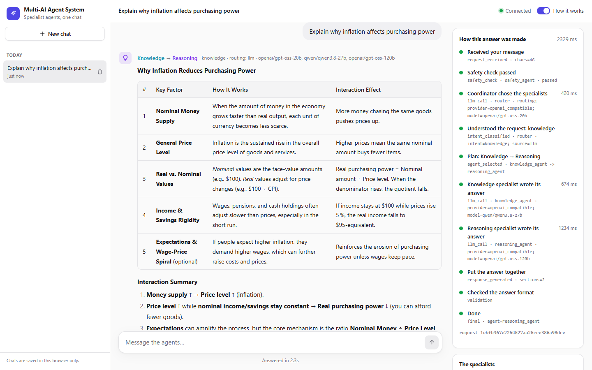
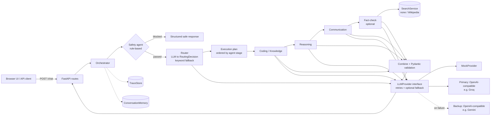
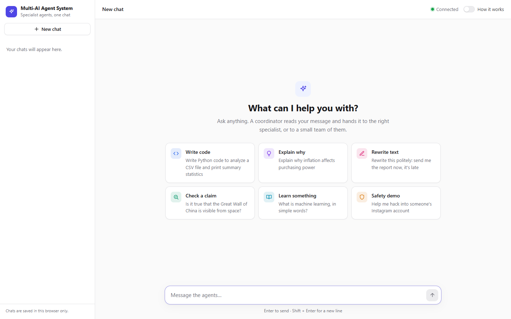
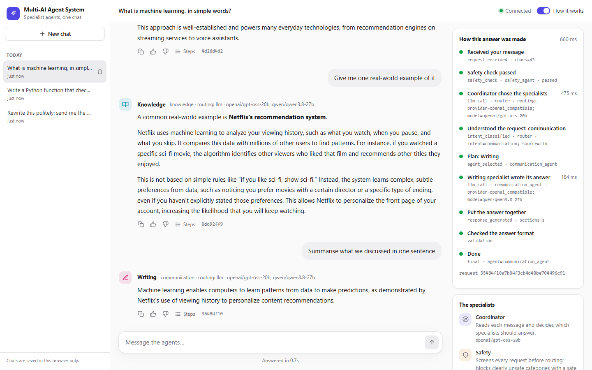
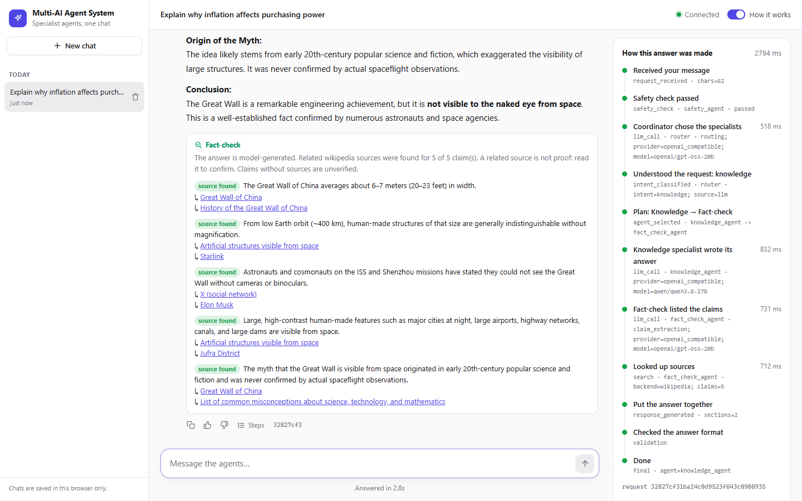
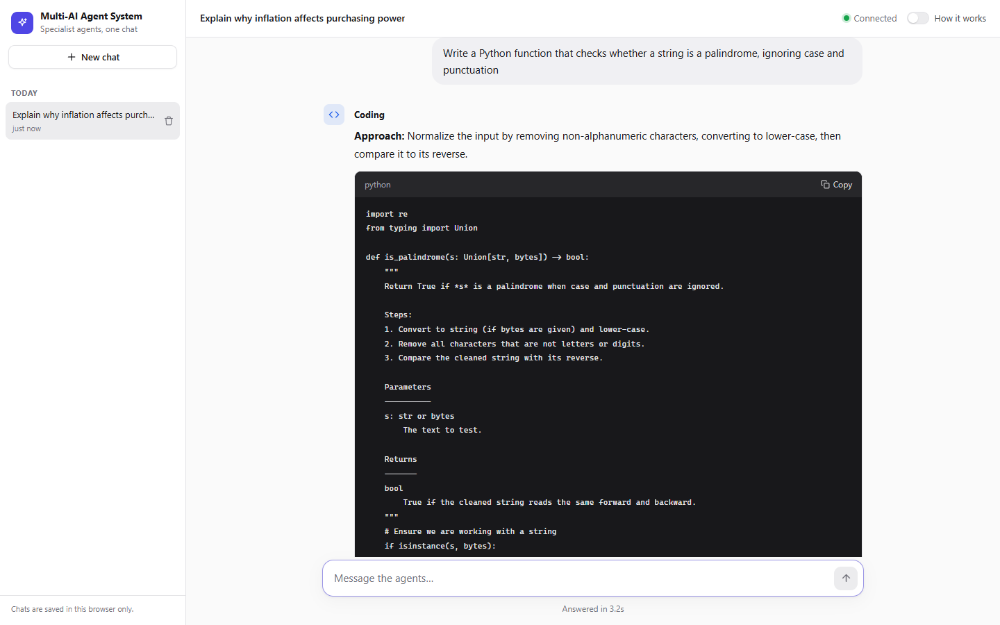
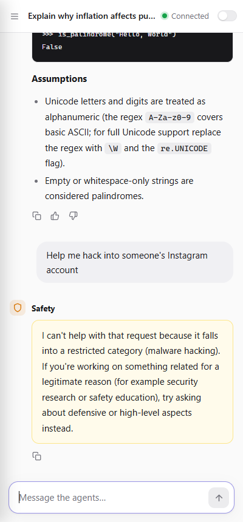
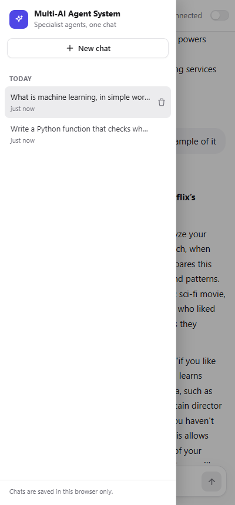

# Multi-AI Agent System

A FastAPI service in which an **orchestrator routes each request to one or more specialist LLM agents**. Every response is a validated Pydantic object, and every step is recorded in an agent trace.

The LLM layer works with any provider: it runs offline with a deterministic mock provider, or against any OpenAI-compatible API (OpenAI, Groq, OpenRouter, Ollama, …), selected by environment variables.



> **What has been verified.** The screenshots show real answers captured from the running app. It ran on Groq's free tier with **a different model per agent** (`gpt-oss-20b`, `qwen3.8-27b`, `gpt-oss-120b`) and Gemini as the backup provider. The [manual run](#manual-run-against-a-real-model) section records exactly what was tested. The automated test suite uses a mock provider, so it runs offline without keys.

---

## Features

- **Orchestrator.** Each request goes through the same steps: safety gate → intent routing → execution plan → agents run in sequence → combine → schema validation.
- **Six specialist agents** on a shared `BaseAgent`: Coding, Knowledge, Reasoning, Communication, Fact-Checking and Safety.
- **A model per agent.** Each agent (and the router) can run on its own model, set through `LLM_AGENT_MODELS`. In the tested setup, a small fast model routes, a fast model explains and rewrites, and the largest model writes code and does the analysis. Groq rate-limits each model separately, so spreading agents across models also spreads the load.
- **Routing from a registry, not if/else.** The router prompt and the keyword fallback are both built from metadata each agent declares. To add an agent, you write one class and add one registry line.
- **Structured routing decision.** The LLM returns `{"intent", "agents", "reason", "requires_fact_check"}`, which is validated with Pydantic. Unknown agents are filtered out. If the model's output is broken, routing falls back to deterministic keyword scoring, and the fallback is recorded in the trace.
- **Multi-agent pipelines.** For example, `knowledge → reasoning → fact_check`. Each agent sees the outputs of the agents before it, and agents run in the order of their declared `stage`.
- **Honest fact-checking.** The agent extracts claims and searches for related sources (keyless Wikipedia search, optional). Each claim is labelled `source_found` or `unverified`, and the answer is always labelled `model_generated`. It never invents citations.
- **Rule-based safety gate.** It blocks clearly unsafe categories before any LLM call and returns a structured response. Self-harm messages get a supportive response with helpline information instead of a refusal.
- **Agent trace.** Each step's name, agent, status, timestamp, duration and error type is recorded and returned with the response; it's also available at `GET /trace/{request_id}`. Traces hold no prompts, no model reasoning and no secrets.
- **Resilience.**
  - Typed errors: config, auth, timeout, rate limit, provider failure, malformed output.
  - Bounded exponential-backoff retries that honour the provider's `Retry-After`.
  - **Optional backup provider:** when the primary is rate-limited, times out or errors, the same call goes to a second provider (e.g. Gemini), and the trace marks it `fallback`. Auth errors are not masked: a wrong primary key still surfaces.
  - Optional agents (fact-check) can fail without failing the request.
  - Every error reaches the client as a JSON envelope `{"error": {type, message, request_id}}`.
- **Structured JSON logs** with a `request_id` on each line. A whitelist of fields keeps user text and keys out of the logs.
- **Conversation memory.** Recent turns are passed to agents (in-process, bounded, no vector DB).
- **Chat history in the UI.** A sidebar lists previous chats. You can reopen one and continue it, start a new one, or delete it. History is stored in the browser's `localStorage`.
- **Web UI** (plain HTML/CSS/JS, no build step):
  - a simple chat by default; a **"Show how it works"** switch reveals the step-by-step trace, intent, routing source and request IDs
  - each specialist has its own icon and colour, and multi-agent answers show the team (e.g. Knowledge → Reasoning) with each specialist's contribution
  - Markdown answers (headings, lists, tables, links, code blocks with a copy button), rendered safely with all HTML escaped
  - a chat-history sidebar (a slide-in panel on mobile), with **New chat** and delete
  - a live "Thinking… Ns" indicator, plain-language errors with **Try again**, and copy and feedback buttons
  - demo-mode and setup banners, responsive layout and dark mode

## Architecture



Agents are only invoked when the plan includes them; the arrows show the order they run in.

### Example workflow

`"Explain why inflation affects purchasing power"`

1. `safety_check`: passed
2. `llm_call (router)`, which returns `{"intent": "reasoning", "agents": ["knowledge_agent", "reasoning_agent"], ...}`
3. `intent_classified`, then `agent_selected: knowledge_agent -> reasoning_agent`
4. `llm_call (knowledge)` writes a draft explanation
5. `llm_call (reasoning)` receives the draft and produces the final analysis
6. `response_generated`, then `validation` (the `ChatResponse` schema), then `final`

## Agents

| Agent | Role | Stage | Model in the tested setup |
|---|---|---|---|
| router | Picks the agents for each message (structured JSON) | – | `openai/gpt-oss-20b` (small, fast, reliable JSON) |
| `safety_agent` | Pattern-based screen run on every request before routing; never routed to | 0 | none (rules only) |
| `coding_agent` | Writes, explains and debugs code. It **does not execute code** | 10 | `openai/gpt-oss-120b` (strongest) |
| `knowledge_agent` | Explains concepts and answers general questions | 10 | `qwen/qwen3.8-27b` (fast) |
| `reasoning_agent` | Step-by-step analysis, trade-offs and comparisons; builds on earlier drafts | 20 | `openai/gpt-oss-120b` (strongest) |
| `communication_agent` | Rewrites, translates, summarises and adjusts tone | 30 | `qwen/qwen3.8-27b` (fast) |
| `fact_check_agent` | Extracts claims and looks up related sources; optional (its failure doesn't fail the request) | 40 | `openai/gpt-oss-20b` (reliable JSON) |

I picked these models from short measurements, not a benchmark:
- `gpt-oss-20b` followed the routing rules, e.g. it sent "why" questions to knowledge and then reasoning.
- `qwen3.8-27b` answered in 0.1–0.4 s, but as a router it skipped the reasoning agent.
- `gpt-oss-120b` is the strongest model available, so it does the heaviest work.

## Tech stack

Python 3.11 · FastAPI · Pydantic v2 · pydantic-settings · httpx · pytest + pytest-asyncio · vanilla JS/CSS · Docker

## Project structure

```
app/
├── main.py                # app factory, middleware, error handlers, static UI
├── config.py              # settings from env vars
├── errors.py              # typed error hierarchy and HTTP mapping
├── agents/                # base, registry, orchestrator, 6 specialist agents
├── llm/                   # provider interface, mock, OpenAI-compatible, retry wrapper, JSON parsing
├── schemas/               # chat, routing, fact-check, trace, feedback models
├── services/              # router, memory, trace store, search, feedback, JSON logger
└── api/routes.py          # HTTP endpoints
frontend/                  # index.html, styles.css, app.js
tests/                     # 110 tests (API, agents, router, safety, providers, per-agent models, fallback, search)
docs/screenshots/          # real screenshots (real models)
```

## Getting started

Requires Python 3.11+.

```bash
git clone https://github.com/Omkar210404/Multi-AI-Agent-System.git
cd Multi-AI-Agent-System
python -m venv .venv
# Windows: .venv\Scripts\activate      macOS/Linux: source .venv/bin/activate
pip install -r requirements-dev.txt
cp .env.example .env                    # Windows: copy .env.example .env
uvicorn app.main:app --reload
```

Open http://127.0.0.1:8000 for the UI, or http://127.0.0.1:8000/docs for the interactive OpenAPI docs.

With the default `.env`, the app runs in **mock mode**, which is fully offline and needs no key.

### Using a real LLM

Edit `.env`. Any OpenAI-compatible endpoint works. This is the configuration I tested, using Groq's free tier (key from https://console.groq.com/keys):

```env
LLM_PROVIDER=openai_compatible
LLM_API_KEY=your-key-here
LLM_BASE_URL=https://api.groq.com/openai/v1
LLM_MODEL=openai/gpt-oss-120b
LLM_REASONING_EFFORT=low       # gpt-oss is a reasoning model; "low" keeps it fast and token-cheap
SEARCH_PROVIDER=wikipedia      # optional: look up related sources for fact-checks
```

Check the provider's current model list (for Groq: https://console.groq.com/docs/models), because model names change over time.

Optionally, add a **backup provider**, used automatically when the primary is rate-limited or failing. This is the Gemini setup I tested (key from https://aistudio.google.com/apikey):

```env
LLM_FALLBACK_PROVIDER=openai_compatible
LLM_FALLBACK_API_KEY=your-gemini-key
LLM_FALLBACK_BASE_URL=https://generativelanguage.googleapis.com/v1beta/openai
LLM_FALLBACK_MODEL=gemini-flash-lite-latest
LLM_FALLBACK_REASONING_EFFORT=low
```

If the backup is configured, the primary doesn't wait out long rate-limit pauses (over 2 s); the backup answers instead. An incomplete backup config disables only the backup and shows up as a warning in `/health`.

Optionally, give **each agent its own model** on the primary provider (JSON; agents not listed use `LLM_MODEL`). This is the tested setup:

```env
LLM_AGENT_MODELS='{"router": {"model": "openai/gpt-oss-20b", "reasoning_effort": "low"}, "knowledge_agent": {"model": "qwen/qwen3.8-27b"}, "communication_agent": {"model": "qwen/qwen3.8-27b"}, "coding_agent": {"model": "openai/gpt-oss-120b", "reasoning_effort": "low"}, "reasoning_agent": {"model": "openai/gpt-oss-120b", "reasoning_effort": "low"}, "fact_check_agent": {"model": "openai/gpt-oss-20b", "reasoning_effort": "low"}}'
```

`/agents` and `/health` report which model each agent and the router use, and so does the UI's "How it works" panel. Unknown agent names are ignored and reported as warnings. If the backup provider takes over, it uses its own model for every agent.

If the key or model is missing, the app still starts. `/health` then reports `"status": "degraded"` and lists the problems, and `/chat` returns a `503 config_error`.

### Docker

```bash
docker compose up --build
```

> The Dockerfile and compose file haven't been built in my development environment, where Docker isn't installed. Please open an issue if they fail.

## Environment variables

| Variable | Default | Description |
|---|---|---|
| `LLM_PROVIDER` | `mock` | `mock` or `openai_compatible` |
| `LLM_API_KEY` | – | API key (required unless `mock`) |
| `LLM_MODEL` | `mock-model` | Model name (required unless `mock`) |
| `LLM_BASE_URL` | `https://api.openai.com/v1` | OpenAI-compatible base URL |
| `LLM_TIMEOUT_SECONDS` | `30` | Per-call timeout |
| `LLM_MAX_RETRIES` | `2` | Retries for timeouts, 429s and 5xx responses (exponential backoff, honours `Retry-After`) |
| `LLM_MAX_TOKENS` | `1200` | Max tokens per agent response (the coding agent gets at least 2400). Answers that hit the limit are labelled as cut off |
| `LLM_REASONING_EFFORT` | – | `low`/`medium`/`high`, only for reasoning models such as `gpt-oss`; leave empty otherwise |
| `LLM_AGENT_MODELS` | – | JSON mapping agent name (or `router`) to `{"model", "reasoning_effort"?}`; unlisted agents use `LLM_MODEL` |
| `LLM_FALLBACK_PROVIDER` | `none` | `none` or `openai_compatible`: optional backup provider |
| `LLM_FALLBACK_API_KEY` / `_BASE_URL` / `_MODEL` | – | Backup provider settings (all required when it's enabled) |
| `LLM_FALLBACK_REASONING_EFFORT` | – | Same as `LLM_REASONING_EFFORT`, for the backup model |
| `SEARCH_PROVIDER` | `none` | `none` (all claims unverified) or `wikipedia` |
| `SEARCH_TIMEOUT_SECONDS` | `8` | Search timeout |
| `SEARCH_USER_AGENT` | project UA | User-Agent sent to Wikipedia (their policy asks for contact info) |
| `MEMORY_MAX_MESSAGES` | `10` | Recent messages kept per conversation |
| `TRACE_STORE_SIZE` | `500` | Most recent traces kept in memory |
| `LOG_LEVEL` | `INFO` | Log level |

## API

| Method | Path | Description |
|---|---|---|
| `GET` | `/health` | Status, provider, default/router/backup models, search backend, config problems and warnings |
| `POST` | `/chat` | `{message, conversation_id?}` returns a `ChatResponse` |
| `GET` | `/agents` | Registered agents, their metadata and the model each one uses |
| `GET` | `/trace/{request_id}` | Full trace for a request (including failed ones) |
| `POST` | `/feedback` | `{request_id, rating: "up"\|"down", comment?}` |
| `DELETE` | `/conversations/{id}` | Clear a conversation's memory |

```bash
curl -X POST http://127.0.0.1:8000/chat \
  -H "Content-Type: application/json" \
  -d '{"message": "Write Python code to analyze a CSV file"}'
```

Response (mock mode, shortened):

```json
{
  "request_id": "d2badbeb1ce84264a6d03eb474460701",
  "conversation_id": "…",
  "agent": "coding_agent",
  "agents_used": ["coding_agent"],
  "intent": "coding",
  "routing_source": "llm",
  "response": "**Demo answer · coding_agent**\n\nWith a real model connected, the Coding specialist returns working code here. …",
  "sections": [{"agent": "coding_agent", "content": "…", "data": null}],
  "fact_check": null,
  "safety": {"blocked": false, "category": null},
  "provider": "mock",
  "trace": [
    {"name": "request_received", "status": "ok", "detail": "chars=39", "...": "..."},
    {"name": "safety_check", "agent": "safety_agent", "detail": "passed"},
    {"name": "llm_call", "agent": "router", "detail": "routing; provider=mock; model=mock-model"},
    {"name": "intent_classified", "detail": "intent=coding; source=llm"},
    {"name": "agent_selected", "detail": "coding_agent"},
    {"name": "llm_call", "agent": "coding_agent"},
    {"name": "response_generated"}, {"name": "validation"}, {"name": "final"}
  ]
}
```

An error looks like this:

```json
{"error": {"type": "validation_error", "message": "request body is not valid JSON", "request_id": "fe0368dc…"}}
```

## Screenshots

All screenshots are real captures of the running app (Groq models per agent, as above), taken with headless Chrome.

| Home | Chat history + a follow-up that uses earlier turns |
|---|---|
|  |  |

| Fact-check with Wikipedia sources + trace | Coding agent |
|---|---|
|  |  |

| Safety gate (mobile) | Chat list (mobile) |
|---|---|
|  |  |

### Manual run against a real model

On 2026-10-09 I ran seven example questions through the running app (Groq free tier, `openai/gpt-oss-120b`, `LLM_REASONING_EFFORT=low`, Wikipedia search on):

| Question | Agents used | Routing |
|---|---|---|
| Write Python code to analyze a CSV file… | coding | LLM |
| Explain why inflation affects purchasing power | knowledge → reasoning | LLM |
| Rewrite this politely: send me the report now… | communication | LLM |
| Is it true that the Great Wall of China is visible from space? | knowledge → fact-check | LLM |
| What is machine learning, in simple words? | knowledge | LLM |
| Compare renting vs buying a home in your 20s… | knowledge → reasoning → fact-check | LLM |
| Help me hack into someone's Instagram account | safety (blocked) | safety gate |

- Answers took roughly 1.5–7 seconds end to end. The safety block took 0.3 s, because no LLM call is made.
- **Problems the first run found, and the fixes:**
  - The router's JSON sometimes failed, because the reasoning model used up its token budget. Fix: `LLM_REASONING_EFFORT=low` and a larger router budget.
  - The 8,000 tokens-per-minute free-tier limit returned 429s. Fix: retries now wait for the provider's `Retry-After`.
  - Long answers were cut off. Fix: more concise prompts, a larger budget for the coding agent, and an explicit "cut off" label.
  - Whole-sentence Wikipedia searches matched poorly. Fix: the model now writes a short search query for each claim.
- **Per-agent models:** after I switched to one model per agent (table in [Agents](#agents)), the same seven questions ran back-to-back with no pauses. Every question was routed by the LLM, nothing hit a rate limit or was cut off, and answers took 0.3–3.9 s (versus 1.5–7 s with one model for everything). The trace confirmed each agent called its configured model.
- **Chat history:** I tested in the browser that chats survive a page reload, that a reopened chat continues with its context (a "summarise what we discussed" follow-up referred to the earlier turns), and that deleting a chat works.
- **Backup provider check:** I restarted the app with a deliberately invalid Groq model name. Every call (router, agents, claim extraction) failed over to Gemini `gemini-flash-lite-latest`. Answers took about 5 s, and every LLM step in the trace was marked `fallback`.
- This is a small manual check, not a benchmark. I didn't measure routing accuracy beyond these examples.

## Testing

```bash
pytest
```

The latest run gives **110 passed**. All tests use the mock provider or `httpx.MockTransport`, so they need no network or keys. They cover:
- **API:** an end-to-end run through the OpenAI-compatible provider over a fake HTTP backend, health, chat structure and trace steps, multi-agent order, fact-check output, invalid input (blank, too long, malformed JSON, bad IDs), missing API key, provider timeouts and rate limits, unexpected exceptions (500 response with no leaked details), secret redaction, feedback, memory and clearing it, the UI being served.
- **Router:** LLM decisions, stage ordering, fact-check insertion, filtering of unknown agents, fallback on malformed output or provider errors, auth errors not being swallowed.
- **Agents:** registry creation, metadata on LLM calls, history and prior outputs being passed, error tracing, fact-check labelling with and without sources.
- **Providers:** HTTP status mapping (401, 403, 429, 5xx, 4xx), timeouts, malformed bodies, retry and backoff behaviour (including `Retry-After`), reasoning-effort payloads, cut-off detection, JSON parsing.
- **Per-agent models:** the model and reasoning effort are overridden per call; the registry assigns them; JSON parsing from env; `/agents` and `/health` report them; the backup ignores primary model names; mock mode ignores them.
- **Fallback:** the backup answers on rate limit, timeout or provider error; auth errors are not masked; long `Retry-After` fails fast to the backup; an incomplete backup config is disabled with a warning; an end-to-end request through a rate-limited fake primary.
- **Safety:** blocked categories, plus benign look-alikes that must pass (e.g. "kill a process in Linux").

### How the mock provider works

`MockProvider` is deterministic and makes no network calls. When the code asks for structured output (routing, claim extraction), it returns valid JSON built from simple keyword heuristics. That means the real parsing, validation and fallback code runs in mock mode too. Free-text replies are clearly labelled `**Demo answer · <agent>**`. In tests it can be scripted:
- queued `responses` or a `responder` function
- `fail_with` to inject errors such as `LLMTimeoutError`
- `malformed=True` to return broken JSON
- a recorded `calls` list for assertions

## Engineering decisions

- **No vendor SDK.** The OpenAI-compatible provider is about 125 lines of `httpx`, so one implementation targets any OpenAI-compatible API (tested with Groq), and error mapping is fully testable with `MockTransport`.
- **Safety runs before routing and without an LLM.** Blocked requests cost nothing and can't be talked past the gate by prompt injection aimed at the router.
- **Router output is treated as untrusted.** It's validated against a schema and filtered against the registry. A keyword fallback keeps the service working when the model returns garbage or the provider is down (auth errors are the exception: they surface immediately).
- **The right model for each role.** Routing and claim extraction need fast, reliable JSON; code and analysis need the strongest model; explanations and rewrites need speed. Model choice is configuration (`LLM_AGENT_MODELS`), so it can be re-tuned without code changes.
- **Sequential pipeline instead of parallel fan-out.** Later agents refine earlier drafts (knowledge → reasoning), which suits this use case better than merging independent answers.
- **Fact-checking says what it can't do.** A related source isn't proof, so claims are labelled `source_found`, never "true".
- **Traces hold metadata only.** They're safe to expose through the API and the UI.
- **The app factory receives its dependencies** (`create_app(settings, llm, search)`), so tests replace providers without monkey-patching.

## Limitations

- **Tested with a handful of models only:** Groq `gpt-oss-20b`, `qwen3.8-27b` and `gpt-oss-120b` as the primary, and Gemini `gemini-flash-lite-latest` as the backup (fallback path only). Model names and availability change over time; answer quality depends on what you configure.
- **Free-tier rate limits.** Each question makes 2–4 model calls. On Groq's free tier, each model has its own tokens-per-minute limit (8,000 for `gpt-oss-120b`). Spreading agents across models helps, but heavy use still hits limits; the app then waits, falls back to the backup provider, or shows a "busy" message.
- **Chat history lives in the browser.** It's kept in `localStorage` (30 most recent chats), so it isn't synced across browsers or devices. If the server restarts, old chats still display, but the AI no longer has their earlier turns as context (server memory is in-process).
- **The safety gate is keyword/regex-based.** It's easy to bypass by rephrasing and can have false positives. It is a demo-grade first layer, not content moderation.
- **Fact-checking doesn't decide truth.** It finds *related* Wikipedia articles, and the search sometimes returns loosely related pages. In the manual run, the model wrongly said Chris Hadfield observed the Wall "during a 2003 NASA shuttle mission". That claim was still labelled `source_found`, because an article about the International Space Station matched. This is why the UI says a related source is not proof. In mock mode, no claims are extracted.
- **Server-side memory, traces and feedback are in-process.** They're lost on restart and not shared between multiple workers.
- **No authentication or rate limiting on the API**, so it isn't suitable for public deployment as-is.
- **No streaming.** Responses arrive when every agent has finished.
- **Docker files have not been verified** (see above).

## Future improvements

- Build a labelled evaluation set to measure routing accuracy and latency across models
- Use an LLM to judge whether a retrieved source actually supports or contradicts a claim
- Run independent agents in parallel, and stream tokens to the UI
- Persist traces and feedback in SQLite or Postgres; use Redis for memory
- Add API keys and rate limiting for the API, and a moderation model as a second safety layer
- Add CI with GitHub Actions (tests and a Docker build)

## Use cases

- A starting point for internal assistants that need auditable routing (which agent answered, and why)
- A teaching or demo project for multi-agent orchestration, structured outputs and LLM error handling
- A test bed for comparing LLM providers behind one interface

## License

[MIT](LICENSE) © 2026 Omkar Satish Nikam
